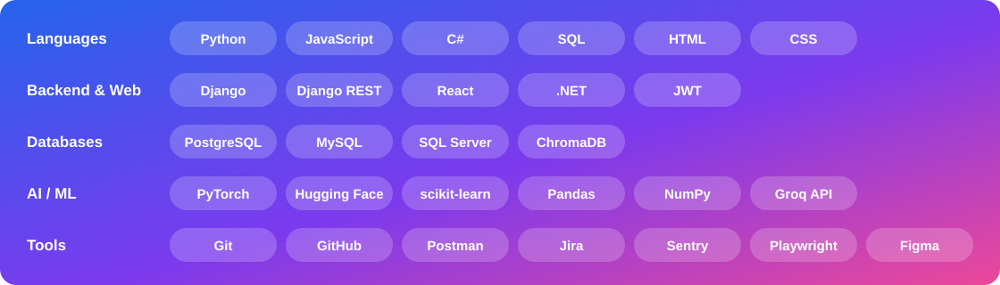

 

---

## 👨‍💻 About Me

I'm a final-year **Software Engineering** student at **Bahria University Karachi**. I build **Django REST APIs** and full-stack web apps, and I like putting **machine learning** inside real backends.

- 🔭 Working with Django, React, PostgreSQL and LLM / vector-search pipelines
- 🧠 Exploring model fine-tuning, semantic search and AI-powered products
- 🌱 Focused on clean, tested, maintainable code
- 🔁 My motto: **Build. Struggle. Rest. Repeat.**

---

## 🛠️ Skills

---

## ⭐ Featured

🎯 **[Job Hunter](https://github.com/jawadUlHassan069/job-hunter)**: AI-powered CV & job matching platform · [Live demo](https://job-hunter-tau-eight.vercel.app)

*More in my pinned repositories above 👆*
